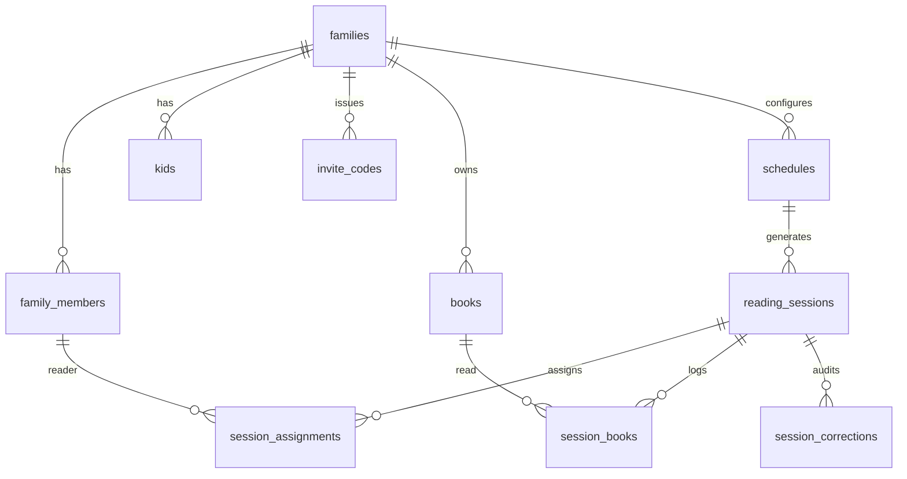

# Bedtime Readers

Family bedtime reading tracker: whose night it is, book library, scheduled reading sessions with ICS calendar invites, and a parent dashboard.

## Status

| Field | Value |
|-------|-------|
| Status | in-progress (demo app shipping on main) |
| Owner session | cloud agent (new project) |
| Last updated | 2026-10-04 |
| Related PR / branch | `main` |

## Goals (v1)

- **Auth** — Email/password + Google OAuth via Supabase Auth; password reset emails.
- **Family** — Create a family or join via invite code; add kids; invite other adults (co-parents, grandparents, caregivers) as readers.
- **Whose night** — Default home route shows the signed-in reader's next upcoming reading session.
- **Schedule** — Create recurring schedules (e.g. alternate parents reading to both kids together); optional pre-select books or log books after reading.
- **Sessions** — Auto-create calendar nights from the schedule; edit future sessions; cancel sessions; correct past sessions with a clear audit trail (original assignment preserved).
- **Calendar** — Each session sends an ICS invite via Plunk to assigned readers.
- **Library** — Family book inventory; Open Library lookup by title/author; all kids share the family library (no per-kid ownership in v1).
- **Dashboard** — Books-read stats (all-time, recent) with filter: default current user, also per-reader or whole family.
- **Jobs** — Upstash QStash for scheduled work (session generation / reminder sends when needed).
- **Quality** — Comprehensive unit tests; GitHub Actions CI must pass before PRs are mergeable.
- **Out of scope for v1:** Profile pictures; per-kid book ownership; native Google Calendar API; mobile apps.

## Todos

1. Scaffold Next.js (App Router) + TypeScript + Tailwind + ESLint + Prettier + shadcn/ui.
2. Supabase schema, RLS, Auth (Google + email/password + reset).
3. Family create/join, members, kids, invite codes.
4. Family library + Open Library search.
5. Schedules + reading sessions (create/edit/cancel/correct + audit).
6. Plunk + ICS invites; QStash hooks for generation/reminders.
7. Home (next session) + stats dashboard with filters.
8. Unit test suite (Vitest) + GitHub Actions CI required status.
9. README, `.env.example`, local mock fallbacks where secrets are absent.

## Current state

Greenfield repo (seeded README only). Implementation lands on `main`.

## Design

### Stack

| Layer | Choice | Why |
|-------|--------|-----|
| App | Next.js App Router on Vercel | Requested full-stack hosting |
| DB + Auth | Supabase (Postgres) | Relational families/schedules/audit trail fit SQL; Auth includes Google + password reset |
| UI | Tailwind + shadcn/ui | Requested |
| Email | Plunk + ICS attachments | Calendar invites without Google Calendar OAuth |
| Jobs | Upstash QStash | Cron for ahead-of-time session generation / reminder emails |
| Books | Open Library Search API | Free, no key required for search |
| Tests | Vitest + Testing Library | Fast unit/component tests |
| CI | GitHub Actions | Block PR merge on failing tests |

Firebase was considered; Postgres wins for joins, invite codes, schedule rules, and correction history.

### Data model (Postgres)

- **families** — `id`, `name`, `created_by`, timestamps
- **family_members** — `family_id`, `user_id`, `display_name`, `role` (`owner` | `reader`), `email`
- **kids** — `family_id`, `name`, `age`, optional `avatar_url` (unused in v1 UI)
- **invite_codes** — `family_id`, `code`, `expires_at`, `max_uses`, `uses`, `created_by`
- **books** — `family_id`, `title`, `authors`, `open_library_key`, `cover_url`, `isbn`
- **schedules** — `family_id`, `mode` (`together` | `per_kid` later), `reader_rotation` (ordered member ids), `start_date`, `time_local`, `timezone`, `book_timing` (`ahead` | `after`), `active`
- **reading_sessions** — `family_id`, `schedule_id?`, `scheduled_for`, `status` (`scheduled` | `completed` | `cancelled`), `notes`, `ics_uid`
- **session_assignments** — `session_id`, `member_id`, `is_original` (true for first assignment row kept forever)
- **session_books** — `session_id`, `book_id?`, `title_freeform?`
- **session_corrections** — `session_id`, `corrected_by`, `reason`, `before_json`, `after_json`, `created_at`

Correction rule: editing a past session never deletes original assignment rows (`is_original = true`). UI shows “Originally assigned: …” whenever a correction exists.

### Auth & roles

- Supabase Auth: email/password, Google provider, password recovery.
- After signup, user must create or join a family before using the app.
- Any joined adult is a **reader** (parents, grandparents, others). Family creator is **owner** (can manage invites/kids/schedules). Owners can promote later if needed; v1 treats owners as full admins and readers as able to log/correct/cancel sessions.

### UX routes

| Route | Purpose |
|-------|---------|
| `/` | Redirect: next session for current user if in a family; else onboarding |
| `/login`, `/signup`, `/reset-password` | Auth |
| `/onboarding` | Create family or enter invite code |
| `/sessions/[id]` | Session detail / edit / cancel / correct |
| `/schedule` | Manage rotation + generate upcoming nights |
| `/library` | Family books + Open Library search |
| `/kids` | Add/edit kids |
| `/family` | Members + invite codes |
| `/dashboard` | Stats with reader/family filter |

### Email / ICS / QStash

- On session create/update (future): build `.ics` (VEVENT with UID = `ics_uid`), send via Plunk to assigned reader emails (`METHOD:REQUEST`; cancel uses `METHOD:CANCEL`).
- QStash cron (daily): ensure N days of future sessions exist from active schedules; optional reminder email morning-of.
- Local/dev without secrets: log email payloads; skip real send.

### Testing & CI

- Vitest unit tests for: rotation algorithm, session generation, correction audit helpers, ICS builder, invite code validation, dashboard aggregations, authz helpers.
- GitHub Actions: `lint` + `test` on PR and `main`; branch protection note in README (require `test` check).

## Critical decisions

- **Supabase over Firebase** — relational schedule + audit history.
- **ICS over Google Calendar API** — Plunk-delivered invites; no Calendar OAuth.
- **Shared family library** — no per-kid ownership in v1.
- **Readers beyond parents** — any adult joining via invite can be in the rotation.
- **Mocks when env missing** — app runs locally with in-memory/demo mode if Supabase/Plunk/QStash are unset (documented in README).

## Files to touch

| Path | Change |
|------|--------|
| `src/app/**` | Routes and server actions |
| `src/components/**` | UI (shadcn-based) |
| `src/lib/**` | Supabase clients, ICS, Plunk, QStash, Open Library, domain logic |
| `supabase/migrations/**` | SQL schema + RLS |
| `tests/**` | Vitest unit tests |
| `.github/workflows/ci.yml` | Lint + test gate |
| `.env.example` | Required env vars |
| `README.md` | Product + local run + CI notes |

## Acceptance criteria

- [ ] Parent can sign up (email or Google), reset password, create or join a family via invite.
- [ ] Parent can add kids and invite other adult readers.
- [ ] Family can build a book library via Open Library search.
- [ ] Schedule rotates readers; home shows my next session.
- [ ] Sessions create ICS emails to assignees; cancel sends cancel ICS.
- [ ] Past session corrections keep original assignment visible.
- [ ] Dashboard filters books-read by me / other reader / whole family.
- [ ] Unit tests cover core domain logic; CI fails the PR if tests fail.

## Handoff

> Updated by `/handoff`. `/feature-context` reads this first.

### Done so far

- Requirements locked (ICS, calendar in v1, dashboard filters, cancel, multi-reader invites, tests+CI).
- Feature plan written.
- Next.js app shipped on `main` with demo mode, domain unit tests (25), and GitHub Actions CI.
- Supabase SQL migration + client stubs ready for real credentials.

### Remaining work

- Wire demo store paths to live Supabase Auth/DB once project credentials exist.
- Enable Google provider + password reset emails in Supabase; real Plunk sends; QStash schedule.
- After GitHub repo exists: require `lint-test-build` status check on `main`.

### Blockers / risks

- Real Supabase/Plunk/QStash credentials needed for production auth/email.
- Branch protection must be enabled manually in GitHub.

### Pointers for the next agent

- Start at: replace demo store calls with Supabase queries while keeping domain helpers.
- Do not: add per-kid ownership or profile photos in v1.
- Verify with: `npm test`, `npm run lint`, `npm run build`, manual happy path on home → session → library → dashboard.
